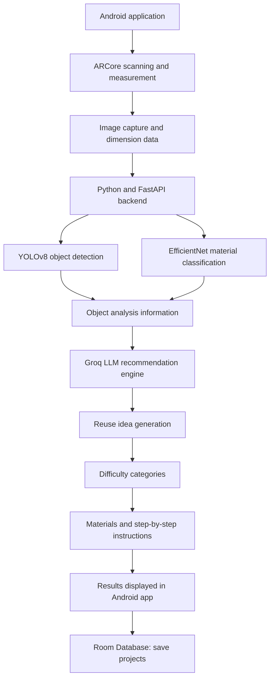

<div align="center">

# RECREATE
### AI-Powered Smart Object Scanning & Reuse Suggestion System

**Scan it. Understand it. Recreate something useful.**

A sustainability-focused Android application that combines augmented reality, computer vision, deep learning, and generative AI to help users discover practical ways to reuse everyday household objects.

</div>

---

## Table of Contents

- [Overview](#overview)
- [Problem Statement](#problem-statement)
- [Objectives](#objectives)
- [Key Features](#key-features)
- [How It Works](#how-it-works)
- [System Architecture](#system-architecture)
- [Technology Stack](#technology-stack)
- [Application Screens](#application-screens)
- [Project Structure](#project-structure)
- [Getting Started](#getting-started)
- [Configuration](#configuration)
- [Team](#team)
- [Limitations and Future Work](#limitations-and-future-work)

## Overview

Reusable household objects are often discarded because people may not know what they are made of or how they can be repurposed. RECREATE aims to make reuse more approachable by turning object scanning into a guided discovery process.

The application allows users to scan selected household objects, estimate their real-world dimensions using an AR-based ruler, analyse the object and its material, and receive AI-generated reuse ideas with structured instructions.

RECREATE brings together:

- **Augmented Reality** for object scanning and dimension measurement.
- **Computer Vision** for object detection.
- **Deep Learning** for material classification.
- **Generative AI** for reuse recommendations and DIY instructions.
- **Local storage** for saving projects and accessing them offline.

## Problem Statement

To develop an intelligent mobile application that detects selected household objects, measures their real-world dimensions using augmented reality, classifies their material composition using deep learning models, and generates structured AI-driven reuse recommendations to encourage sustainable living and reduce material waste.

## Objectives

1. Develop an ARCore-based object-scanning system that detects surfaces using feature points and measures object dimensions through a tap-based AR ruler mechanism.
2. Design a system for object detection and material classification of scanned household objects from predefined categories.
3. Implement an AI-driven reuse recommendation engine that generates categorised reuse ideas — **Easy, Moderate, and Advanced** — with step-by-step guidance.

## Key Features

### 1. ARCore-based object scanning
- Uses Google ARCore for surface detection and spatial tracking.
- Supports object-shape selection: **Flat, Very Flat, Cylindrical, and Cuboidal**.
- Supports sequential scanning of multiple objects.

### 2. AR ruler and dimension measurement
- Uses an anchor-based distance-calculation approach.
- Measures object dimensions based on the selected shape category.
- Dynamically adjusts anchor precision for thin objects.

### 3. Object detection
- Uses **YOLOv8** to detect objects in captured images.
- The project presentation identifies the **COCO dataset** in connection with object detection.

### 4. Material classification
- Uses **EfficientNet** to classify the material of scanned objects.
- The project presentation identifies **MINC-2500** in connection with material classification.

### 5. AI-powered reuse recommendations
- Integrates a **Groq-hosted large language model** to generate reuse ideas.
- Organises suggestions into three difficulty levels:
  - Easy
  - Moderate
  - Advanced
- Generates structured material lists and step-by-step instructions.
- Provides related DIY references to support practical implementation.

### 6. Saved projects and offline access
- Uses **Room Database** to store reuse projects locally.
- Allows users to revisit saved projects offline.

### 7. User guidance
- Includes user guidelines and AR smart tips to help users through the scanning process.

## How It Works

1. **Start scanning:** The user opens the Android application and starts a scan.
2. **Choose object shape:** The user selects the appropriate shape category — Flat, Very Flat, Cylindrical, or Cuboidal.
3. **Measure the object:** ARCore detects surfaces and supports anchor-based dimension measurement through the AR ruler.
4. **Capture the image:** The application captures the object image along with its measurement data.
5. **Analyse the object:** The backend runs object detection using YOLOv8 and material classification using EfficientNet.
6. **Generate reuse ideas:** The object-analysis information is used by the Groq LLM-powered recommendation engine.
7. **Explore instructions:** The user can view categorised reuse ideas, material requirements, step-by-step instructions, and related DIY references.
8. **Save projects:** Projects can be saved locally using Room Database for later offline access.

## System Architecture

The following diagram summarises the main processing flow described in the project presentation.



**Architecture note:** The diagram is a conceptual representation of the project workflow. Refer to the implementation in the repository for the exact module boundaries, API routes, and data flow.

## Technology Stack

| Area | Technology | Role |
|---|---|---|
| Android development | Kotlin, Android Studio | Mobile application |
| Augmented reality | Google ARCore | Surface detection, spatial tracking, and AR measurement |
| Object detection | YOLOv8 | Object detection in captured images |
| Object-detection dataset | COCO | Dataset associated with the detection component |
| Material classification | EfficientNet | Material classification |
| Material dataset | MINC-2500 | Dataset associated with the classification component |
| Backend | Python, FastAPI | API and backend processing |
| Deep-learning framework | PyTorch | Deep-learning implementation |
| Generative AI | Groq LLM | Reuse ideas and instruction generation |
| Local persistence | Room Database | Saving projects and offline access |

## Application Screens

Add screenshots from the completed application to the repository so visitors can see the actual workflow.

Suggested image organisation:

```text
docs/
└── images/
    ├── splash-screen.png
    ├── home-screen.png
    ├── user-guidelines.png
    ├── object-scanning.png
    ├── ar-measurement.png
    ├── object-analysis.png
    ├── ai-recommendations.png
    ├── reuse-instructions.png
    └── saved-projects.png
```

When the screenshots have been added, you can display them here. Replace each path with the exact filename you upload.

| Screen | Preview |
|---|---|
| Home screen | `docs/images/home-screen.png` |
| AR scanning and measurement | `docs/images/ar-measurement.png` |
| Object analysis | `docs/images/object-analysis.png` |
| AI reuse recommendations | `docs/images/ai-recommendations.png` |
| Detailed reuse instructions | `docs/images/reuse-instructions.png` |
| Saved projects | `docs/images/saved-projects.png` |

Example:

```md

```

## Project Documentation

Explore our complete final-year project presentation, covering the problem statement, objectives, methodology, system architecture, implementation, and results.

📄 **[View Final Project Presentation]([docs/RECREATE_Final_Presentation.pdf](https://github.com/1118akshara/Recreate/blob/main/docs/RECREATE_Final_Presentation.pdf.pdf)**

## Project Structure

The repository includes the Android Studio project and the project implementation. The exact directory layout should be confirmed against the current repository before adding more detailed module-level paths here.

At a high level, the project contains:

- Android application source and resources.
- Gradle build and project configuration.
- Backend and AI-processing components used by the application.

For exact paths, API endpoint names, model-weight locations, and backend launch commands, refer to the corresponding files in the repository.

## Getting Started

### Prerequisites

The project presentation specifies the following development and deployment requirements:

**Development system**
- Intel i5 / AMD Ryzen 5 or higher.
- Minimum 8 GB RAM; 16 GB recommended.
- NVIDIA GPU with CUDA support for GPU-based model development/inference.

**Android deployment device**
- ARCore-supported Android smartphone.
- Minimum 4 GB RAM.
- Android 8.0 or later, as specified in the project presentation.

**Software**
- Android Studio.
- Visual Studio Code or another Python development environment.
- Python 3.9 or later.
- FastAPI.
- Google ARCore.
- PyTorch.
- Groq API access.
- Room Database (Android persistence library).

### Clone the repository

```bash
git clone https://github.com/1118akshara/Recreate.git
cd Recreate
```

### Open the Android application

1. Open Android Studio.
2. Select **Open** and choose the cloned repository directory.
3. Allow Gradle sync to complete.
4. Connect an ARCore-supported Android device.
5. Configure the backend address and required credentials as described by the project's configuration files.
6. Build and run the Android application.

### Run the backend

The backend is implemented with Python and FastAPI. The exact backend directory, dependency file, startup command, model paths, and API routes should be taken from the backend files in this repository.

Once those paths are confirmed, add the exact commands here. Do not assume a `requirements.txt`, a particular entry-point filename, or a particular API route unless it exists in the code.

## Configuration

The application integrates with the Groq API. Keep API credentials outside source control.

- Do not commit API keys, passwords, access tokens, or private credentials.
- Use the configuration mechanism expected by the backend.
- If a sample environment file is provided, use placeholder values only.
- Check `.gitignore` and repository history to ensure secrets and local build files are not committed.

## Team

**B.Tech Final-Year Project**  
Department of Information Technology  
Government Engineering College, Palakkad

**Project Guide:** Dr. Sajitha M, Assistant Professor

**Team Members**
- **Adith Raj**
- **Aditya Narayanan**
- **Akshara S**
- **Sayooj Cheleri**

This was developed as a collaborative academic project. Individual contributions should be described accurately when presenting the work in a portfolio or resume.

## Limitations and Future Work

Potential areas for further improvement include:

- Evaluate and improve object-detection and material-classification performance across varied objects, backgrounds, and lighting conditions.
- Measure AR ruler accuracy across different object shapes and device capabilities.
- Improve recommendation relevance and validate generated DIY instructions for practicality and safety.
- Improve handling of network failures, API limits, and unavailable AI services.
- Expand the supported object and material categories.
- Add automated tests and more detailed developer setup documentation.

---

<div align="center">

**RECREATE — Give everyday objects another purpose. ♻️**

[View the GitHub Repository](https://github.com/1118akshara/Recreate)

</div>
